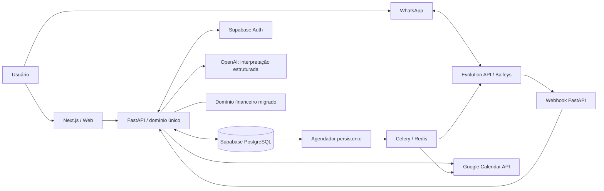

# Arquitetura — visão técnica inicial

**Estado:** arquitetura macro aprovada; estrutura física de pacotes, convenções de API e ownership definidas em GP-02 (`backend/README.md`, `docs/CONTRATOS.md` §4–8). Schema e deployment serão produzidos em F1/F4.

## Diagrama lógico

## Fronteiras de responsabilidade

| Componente | Responsabilidade | Não deve fazer |
|---|---|---|
| Frontend Next.js | UI, fluxo autenticado e consumo de API | Duplicar regras de domínio e guardar segredos |
| FastAPI | Validação, autorização, operações de domínio, orquestração | Confiar em intenções da IA sem validação |
| Supabase | Persistência, Auth, isolamento de dados, estado de sync/jobs | Ser acessado com privilégios elevados pelo cliente |
| OpenAI | Intenção e extração estruturada | Executar SQL ou mutações |
| Evolution API | Transporte WhatsApp | Ser fonte de verdade do histórico funcional |
| Google Calendar | Cópia sincronizada dos compromissos | Definir sozinho o estado do sistema no MVP |
| PostgreSQL + Celery/Redis | Persistir agendamentos e executar tarefas com segurança | Depender de agendamento em memória para eventos futuros |
| Domínio financeiro | Regras financeiras migradas com testes | Manter duas implementações ativas da mesma capacidade |

## Invariantes

- Toda mutação de domínio ocorre no backend, de forma autorizada, auditável e idempotente quando aplicável.
- O registro local existe antes da tentativa de sincronização externa, com `sync_status` visível.
- Webhook recebido repetidamente não repete operações.
- Reagendamento/cancelamento invalida lembretes antigos.
- Revisão noturna descreve somente conclusões confirmadas.
- Horários devem respeitar fuso do usuário; instantes persistidos de forma compatível com UTC.
- O modo Baileys é não oficial e requer planejamento de reconexão/risco operacional.

## Pontos técnicos a definir nas tarefas

- Padrão de migração de banco (GP-03).
- Esquemas concretos, endpoints, política de autorização e versão das bibliotecas.
- Representação validável de recorrência (inclusive último dia do mês).
- Estratégia de tokens Google, retry/backoff, reconciliação e observabilidade.
- Operação de docker/HTTPS/backup/monitoramento na VPS.

**Regra de mudança:** escolhas técnicas novas devem ser justificadas em `docs/DECISOES.md` e refletidas em `docs/CONTRATOS.md`, sem contradizer o `CONTEXTO.md`.
