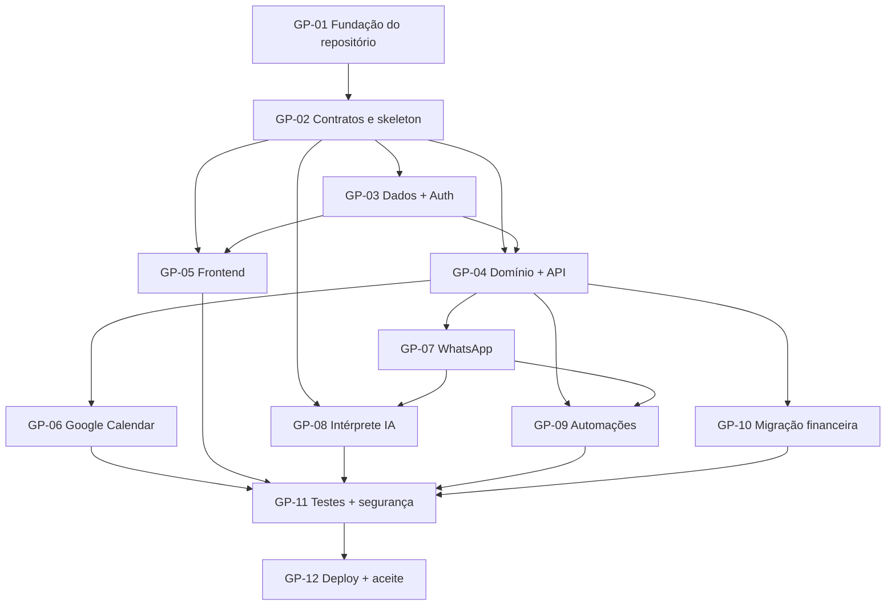

# Plano de desenvolvimento otimizado

**Versão:** 1.0 — planejamento de execução (03/11/2026)  
**Escopo:** MVP do `CONTEXTO.md` v0.2, inclusive migração financeira progressiva.  
**Meta operacional:** 5 fases e **12 prompts-base**, até **3 agentes simultâneos** (não é promessa de 12 interações totais).

## Filosofia de execução

- Um prompt = **uma entrega vertical ou um bloco de implementação com testes**, não um microajuste.
- Paralelismo somente após interfaces mínimas e ownership de arquivos estarem claros.
- Usar modelos intermediários por padrão; modelos fortes em tarefas críticas.
- Trabalhar em branches/worktrees distintas e integrar por etapas curtas.
- Ao encontrar bloqueio por credencial/serviço, entregar testes com mocks e sinalizar claramente a validação pendente.
- Qualidade, segurança e documentação são parte de cada entrega; a fase final as integra, não começa do zero.

## Fases e gates

| Fase | IDs | Objetivo | Gate de saída |
|---|---|---|---|
| F0 — Fundação | GP-01 a GP-02 | Estrutura, regras de colaboração, contratos iniciais, skeleton | CI/local básico e contratos acordados |
| F1 — Núcleo | GP-03 a GP-05 | DB/Auth, API de domínio e frontend | Fluxos web locais com dados persistidos e isolamento |
| F2 — Integrações | GP-06 a GP-08 | Google, WhatsApp e OpenAI híbrida | Caminhos externos funcionais ou validação real explicitamente bloqueada |
| F3 — Automações e finanças | GP-09 a GP-10 | Lembretes/resumos/rotinas e migração financeira | Jobs confiáveis e capacidade financeira migrada com regressão |
| F4 — Estabilização e entrega | GP-11 a GP-12 | Testes integrados, hardening, deployment e observabilidade | Aceites do contexto demonstrados e deploy validado |

A migração financeira **não deve atrasar** a disponibilização inicial do núcleo de produtividade; pode usar uma trilha paralela após GP-04.

## Grafo de dependências

**Nota:** GP-03 e GP-04 podem iniciar parcialmente em paralelo após contratos, mas alterações em schema/auth e sua integração devem passar por um integrador. GP-08 pode adiantar schemas e testes com mocks enquanto GP-07 está em andamento. GP-10 inicia avaliação do repositório financeiro antes do fim das outras integrações.

## Alocação sugerida e modelos

| ID | Responsável preferencial | Modelo/nível inicial | Intensidade prevista |
|---|---|---|---|
| GP-01 | Claude Code | Sonnet | baixa |
| GP-02 | Claude Code | Sonnet; Opus apenas se houver impasse crítico | média |
| GP-03 | Codex | medium | média |
| GP-04 | Claude Code | Sonnet | alta |
| GP-05 | Codex | medium | média |
| GP-06 | Codex | medium; high para OAuth/conciliação difícil | alta |
| GP-07 | Claude Code | Sonnet | alta |
| GP-08 | Codex | medium | média |
| GP-09 | Codex | medium; high se houver bugs concorrentes | alta |
| GP-10 | Claude Code | Opus se a migração exigir raciocínio transversal; Sonnet inicialmente | alta |
| GP-11 | Codex (revisão cruzada) | high para riscos de segurança | alta |
| GP-12 | Claude Code + integrador humano | Sonnet | média |

Modelos são **recomendações por família/esforço**, não identificadores exatos de API; conferir disponibilidade e custo antes de cada tarefa.

## Controle de custo e conflitos

1. Não mandar aos agentes todo o repositório em cada prompt; fornecer caminhos dos documentos e escopo.
2. Uma única pessoa/agente integra migrations, contratos centrais e configuração compartilhada.
3. Priorizar testes focados durante a execução; testes ponta a ponta no gate de fase.
4. Não criar agente específico só para escrever documentação que já faz parte da tarefa.
5. Consolidar correções da mesma entrega antes de gerar novos prompts.
6. Medir esforço real por etapa (interações, bloqueios e retrabalho) e revisar as estimativas após F1.

## Ações humanas previstas

- Confirmar permissões de repositório GitHub e estratégia de branches.
- Criar/acessar projeto Supabase gerenciado; configurar segredos apenas fora do Git.
- Configurar projeto Google Cloud/OAuth e autorização da conta Google, quando chegar GP-06.
- Disponibilizar Evolution API/WhatsApp e validar sessão pessoal, quando chegar GP-07.
- Configurar chaves OpenAI e limites de gasto, quando chegar GP-08.
- Conceder acesso **somente leitura** ao repositório financeiro antigo para análise em GP-10.
- Aprovar deploy, DNS/HTTPS, credenciais da VPS e migrações potencialmente destrutivas em GP-12.

Todas as ações humanas serão repetidas **antes da tarefa concreta**, sem solicitar segredos no chat.

## Medida de sucesso

O MVP estará pronto quando os 10 critérios verificáveis da seção 9 do `CONTEXTO.md` forem demonstrados, com registro de testes, além da conclusão explícita do escopo financeiro pactuado para a migração inicial.
